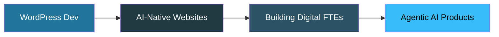

<!-- ===================== HERO BANNER (animated) ===================== -->
<p align="center">
  
</p>

<!-- ===================== TYPING ANIMATION ===================== -->
<p align="center">
  <a href="https://github.com/rahmangamer12">
    
  </a>
</p>

<!-- ===================== TOP BADGES ===================== -->
<p align="center">
  <a href="https://github.com/rahmangamer12?tab=followers">
    
  </a>
  
  
  
</p>


<!-- ===================== ABOUT ===================== -->
<h2>
  
  &nbsp; About Me
</h2>

```typescript
const abdul = {
  age: 18,
  location: "Karachi, Pakistan 🇵🇰",
  role: "AI-Native Web Developer",
  focus: ["WordPress", "Next.js", "Agentic AI", "Motion & 3D UI"],
  currentlyLearning: "Panaversity Agent Factory (Digital FTEs)",
  workflow: "Strong fundamentals + Claude Code + real shipping",
  motto: "Don't just use AI — build with it.",
  openTo: ["Freelance projects", "Remote junior roles", "Collaborations"]
};
```

I'm an 18-year-old developer focused on building real products, not just tutorials. My strongest edge is **WordPress** (custom themes, plugins, REST APIs, WooCommerce), and I extend it with **Next.js**, **Framer Motion** and **AI agents** to ship fast, modern, animated and intelligent websites.

<table>
  <tr><td>🔧</td><td>Custom WordPress themes, plugins and automation systems</td></tr>
  <tr><td>🤖</td><td>AI-powered web experiences with Next.js and the OpenAI Agents SDK</td></tr>
  <tr><td>✨</td><td>Smooth, animated interfaces with Tailwind CSS and Framer Motion</td></tr>
  <tr><td>🍽️</td><td>Website systems for local restaurants and small businesses</td></tr>
  <tr><td>⚡</td><td>Delivered fast, polished work under pressure in live technical tests</td></tr>
  <tr><td>💡</td><td>Exploring Agentic AI, MCP and Digital FTE workflows</td></tr>
</table>


<!-- ===================== TECH STACK ===================== -->
<h2>
  
  &nbsp; My Tech Stack
</h2>

<h4 align="center">🎯 Core: WordPress Ecosystem</h4>
<p align="center">
  
  <br/>
  
  
  
</p>

<h4 align="center">⚛️ Frontend &amp; Motion</h4>
<p align="center">
  
  <br/>
  
  
</p>

<h4 align="center">🤖 AI &amp; Agents</h4>
<p align="center">
  
  
  
  
</p>

<h4 align="center">⚙️ Backend &amp; Tools</h4>
<p align="center">
  
</p>


<!-- ===================== SKILL LEVELS ===================== -->
<h2>
  
  &nbsp; What I Can Build For You
</h2>

<table>
<tr>
<td width="50%" valign="top">

**🌐 Websites**
- Custom WordPress themes and plugins
- WooCommerce stores and REST APIs
- Restaurant and business websites
- Fast Next.js sites deployed on Vercel

</td>
<td width="50%" valign="top">

**🤖 AI Features**
- AI review and reply generators
- Agents built with the OpenAI Agents SDK
- MCP integrations and automation flows
- AI chat widgets for business sites

</td>
</tr>
<tr>
<td width="50%" valign="top">

**✨ Motion UI**
- Scroll and hover animations (Framer Motion)
- Smooth page transitions
- Product customizer interfaces
- Mobile-first responsive layouts

</td>
<td width="50%" valign="top">

**🚀 Delivery**
- Clean, secure and sanitized code
- API testing with Postman
- Git and GitHub workflow
- Clear communication and fast turnaround

</td>
</tr>
</table>


<!-- ===================== FEATURED PROJECTS ===================== -->
<h2>
  
  &nbsp; Featured Projects
</h2>

<table>
<tr>
<td width="50%" valign="top">

### 🤖 AutoReview AI
> AI-powered review management platform for businesses that want faster customer engagement and smarter responses.

**Stack:** Next.js · Supabase · AI generation
<br/><br/>
<a href="https://ai-review-writer.vercel.app/">
  
</a>

</td>
<td width="50%" valign="top">

### 🌐 AIFOD Speaker Directory
> Custom WordPress theme with Speaker CPTs, meta boxes, AJAX filtering and a booking system, built in a live technical challenge.

**Stack:** WordPress · PHP · AJAX · Custom Post Types
<br/><br/>
<a href="https://github.com/rahmangamer12">
  
</a>

</td>
</tr>
<tr>
<td width="50%" valign="top">

### 🔌 Custom WordPress Plugin
> Secure REST API plugin with field validation, nonce checks, sanitized inputs and Postman-tested endpoints.

**Stack:** WordPress · PHP · REST API
<br/><br/>
<a href="https://github.com/rahmangamer12">
  
</a>

</td>
<td width="50%" valign="top">

### 🍽️ Restaurant Website Template
> A reusable multi-restaurant website system so local food businesses can get a modern, fast site quickly.

**Stack:** Next.js · TypeScript · Tailwind CSS · Framer Motion
<br/><br/>
<a href="https://github.com/rahmangamer12">
  
</a>

</td>
</tr>
</table>


<!-- ===================== 3D CONTRIBUTION GRAPH (needs workflow, see notes) ===================== -->
<h2>
  
  &nbsp; 3D Contribution Graph
</h2>

<p align="center">
  
</p>

<!-- ===================== GITHUB STATS ===================== -->
<h2>
  
  &nbsp; GitHub Analytics
</h2>

<p align="center">
  
  
</p>

<!-- ===================== SNAKE (needs workflow, see notes) ===================== -->
<p align="center">
  
</p>


<!-- ===================== ROADMAP ===================== -->
<h2>
  
  &nbsp; What I'm Working Toward
</h2>



- 📜 Completing the Panaversity Agent Factory certification path
- 🧩 Creating an open-source starter kit for AI-powered WordPress sites
- 💼 Taking on freelance clients who want fast, modern, AI-integrated websites
- 📢 Sharing build-in-public updates and practical lessons online


<!-- ===================== CONNECT ===================== -->
<h2 align="center">📫 Let's Work Together</h2>

<p align="center">
I'm available for <b>freelance projects, junior remote roles and collaborations.</b><br/>
Want a website built, or your current site turned into an AI-powered platform? Let's talk. 👇
</p>

<p align="center">
  <a href="https://www.linkedin.com/in/abdul-rahman-program/">
    
  </a>
  <a href="https://github.com/rahmangamer12">
    
  </a>
  <a href="https://ai-review-writer.vercel.app/">
    
  </a>
</p>

<!-- ===================== FOOTER ===================== -->
<p align="center">
  
</p>
