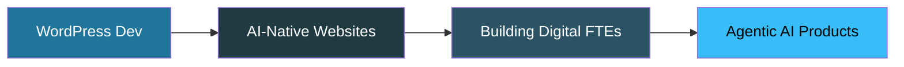

<!-- ============================================================= -->
<!--  ABDUL REHMAN — GitHub Profile README                         -->
<!--  Paste this whole file into a repo named exactly:             -->
<!--  rahmangamer12  ->  README.md                                 -->
<!-- ============================================================= -->

<!-- ===================== HERO BANNER ===================== -->
<p align="center">
  
</p>

<!-- ===================== TYPING ANIMATION ===================== -->
<p align="center">
  <a href="https://github.com/rahmangamer12">
    
  </a>
</p>

<!-- ===================== TOP BADGES ===================== -->
<p align="center">
  <a href="https://github.com/rahmangamer12?tab=followers">
    
  </a>
  
  
</p>

<br/>

<!-- ===================== ABOUT ===================== -->


## 🚀 About Me

```typescript
const abdul = {
  age: 18,
  location: "Karachi, Pakistan 🇵🇰",
  role: "AI-Native Web Developer",
  focus: ["WordPress", "Next.js", "Agentic AI"],
  currentlyLearning: "Panaversity Agent Factory (Digital FTEs)",
  workflow: "I pair strong fundamentals with Claude Code to ship fast",
  motto: "Don't just use AI — build with it.",
  openTo: ["Freelance projects", "Remote junior roles", "Collaborations"]
};
```

I'm an **18-year-old developer** who builds real, production websites and web apps — not tutorials, actual shipped work. My core strength is **WordPress** (custom themes, plugins, REST APIs, WooCommerce), and I extend that with **Next.js** and **AI agents** to build sites that are fast, modern, and intelligent.

- 🔭 I build **custom WordPress plugins & themes** and **AI-powered websites**
- 🌱 Mastering **Agentic AI** — OpenAI Agents SDK, MCP, and Digital FTEs
- ⚡ In a live hiring test I built a full custom theme (CPT + AJAX filter + booking system) in **under 40 minutes**
- 💬 Ask me about turning your existing website into an **AI-powered** one

<br clear="right"/>

---

<!-- ===================== TECH STACK ===================== -->
## 🧰 My Tech Stack

<h4 align="center">🎯 Core — WordPress Ecosystem</h4>
<p align="center">
  
  
  
</p>

<h4 align="center">⚛️ Frontend</h4>
<p align="center">
  
</p>

<h4 align="center">🤖 AI & Agents</h4>
<p align="center">
  
  
  
</p>

<h4 align="center">⚙️ Backend & Tools</h4>
<p align="center">
  
</p>

---

<!-- ===================== FEATURED PROJECTS ===================== -->
## 💎 Featured Projects

<table>
<tr>
<td width="50%" valign="top">

### 🤖 AutoReview AI
> My SaaS product — an AI platform that helps businesses generate and manage customer review responses automatically.

**Stack:** Next.js · Supabase · AI generation
<br/>
[](https://ai-review-writer.vercel.app/)

</td>
<td width="50%" valign="top">

### 🌐 AIFOD Speaker Directory
> Custom WordPress theme built in a live technical test: Speaker CPT, native meta boxes, AJAX org-filter, and a booking system — with clean git history.

**Stack:** WordPress · PHP · AJAX · Custom Post Types
<br/>


</td>
</tr>
<tr>
<td width="50%" valign="top">

### 🔌 Custom WordPress Plugin
> REST API plugin with secure endpoints — sanitized inputs, nonce verification, WP_Error validation, and Postman-tested routes.

**Stack:** WordPress · PHP · REST API
<br/>


</td>
<td width="50%" valign="top">

### ⚡ [Your Next.js / Vercel Project]
> Replace this with any front-end app you deployed on Vercel. Add a one-line description and the live URL.

**Stack:** Next.js · React · Vercel
<br/>


</td>
</tr>
</table>

> 📌 **Pin your 4 best repos** on your profile so these show as cards. (Profile → Customize your pins)

---

<!-- ===================== GITHUB STATS ===================== -->
## 📊 GitHub Analytics

<p align="center">
  
  
</p>

<p align="center">
  
</p>

<!-- ===================== TROPHIES ===================== -->
<p align="center">
  
</p>

<!-- ===================== ACTIVITY GRAPH ===================== -->
<p align="center">
  
</p>

---

<!-- ===================== ROADMAP ===================== -->
## 🎯 What I'm Working Toward



- 📜 Completing the **Panaversity Agent Factory** certification (Level 1 → Digital FTEs)
- 🧩 Building an open-source starter kit for **AI-powered WordPress sites**
- 💼 Taking on freelance clients who want fast, modern, AI-integrated websites
- 📢 Sharing what I learn — build-in-public posts on LinkedIn

---

<!-- ===================== CONNECT ===================== -->
## 📫 Let's Work Together

<p align="center">
I'm available for <b>freelance projects, junior remote roles, and collaborations.</b><br/>
Need a website built — or your current site turned into an AI-powered one? Let's talk. 👇
</p>

<p align="center">
  <a href="https://www.linkedin.com/in/abdul-rahman-program/">
    
  </a>
  <a href="https://github.com/rahmangamer12">
    
  </a>
  <a href="https://ai-review-writer.vercel.app/">
    
  </a>
</p>

<br/>

<!-- ===================== QUOTE ===================== -->
<p align="center">
  
</p>

<!-- ===================== FOOTER ===================== -->
<p align="center">
  
</p>
