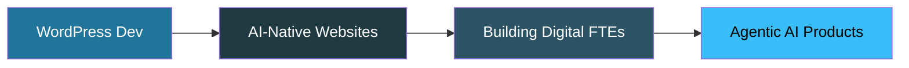

<!-- ============================================================= -->
<!--  ABDUL REHMAN — GitHub Profile README                         -->
<!--  Paste this whole file into a repo named exactly:             -->
<!--  rahmangamer12  ->  README.md                                 -->
<!-- ============================================================= -->

<!-- ===================== HERO BANNER ===================== -->
<p align="center">
  
</p>

<!-- ===================== TYPING ANIMATION ===================== -->
<p align="center">
  <a href="https://github.com/rahmangamer12">
    
  </a>
</p>

<!-- ===================== TOP BADGES ===================== -->
<p align="center">
  <a href="https://github.com/rahmangamer12?tab=followers">
    
  </a>
  
  
  
</p>

<br/>

<!-- ===================== ABOUT ===================== -->
## 🚀 About Me

```typescript
const abdul = {
  age: 18,
  location: "Karachi, Pakistan 🇵🇰",
  role: "AI-Native Web Developer",
  focus: ["WordPress", "Next.js", "Agentic AI"],
  currentlyLearning: "Panaversity Agent Factory (Digital FTEs)",
  workflow: "Strong fundamentals + Claude Code + real shipping",
  motto: "Don't just use AI — build with it.",
  openTo: ["Freelance projects", "Remote junior roles", "Collaborations"]
};
```

I’m an 18-year-old developer focused on building real products, not just tutorials. My strongest edge is WordPress — custom themes, plugins, REST APIs, and WooCommerce — and I extend that with Next.js and AI agents to ship fast, modern, and intelligent websites.

- 🔧 I build custom WordPress themes, plugins, and automation systems
- 🤖 I create AI-powered web experiences with Next.js and modern tooling
- ⚡ I’ve delivered fast, polished work under pressure in live technical tests
- 💡 I’m currently exploring Agentic AI, MCP, and Digital FTE workflows

<br/>

---

<!-- ===================== TECH STACK ===================== -->
## 🧰 My Tech Stack

<h4 align="center">🎯 Core — WordPress Ecosystem</h4>
<p align="center">
  
  
  
</p>

<h4 align="center">⚛️ Frontend</h4>
<p align="center">
  
</p>

<h4 align="center">🤖 AI & Agents</h4>
<p align="center">
  
  
  
</p>

<h4 align="center">⚙️ Backend & Tools</h4>
<p align="center">
  
</p>

---

<!-- ===================== FEATURED PROJECTS ===================== -->
## 💎 Featured Projects

<table>
<tr>
<td width="50%" valign="top">

### 🤖 AutoReview AI
> AI-powered review management platform for businesses that want faster customer engagement and smarter responses.

**Stack:** Next.js · Supabase · AI generation
<br/>
<a href="https://ai-review-writer.vercel.app/">
  
</a>

</td>
<td width="50%" valign="top">

### 🌐 AIFOD Speaker Directory
> Custom WordPress experience with CPTs, meta boxes, AJAX filtering, and booking flows built for a real technical challenge.

**Stack:** WordPress · PHP · AJAX · Custom Post Types
<br/>
<a href="https://github.com/rahmangamer12">
  
</a>

</td>
</tr>
<tr>
<td width="50%" valign="top">

### 🔌 Custom WordPress Plugin
> Secure REST API plugin with validation, nonce checks, sanitized inputs, and testable endpoints.

**Stack:** WordPress · PHP · REST API
<br/>
<a href="https://github.com/rahmangamer12">
  
</a>

</td>
<td width="50%" valign="top">

### ⚡ AI-Ready Modern Web App
> A polished front-end experience designed for speed, UX, and future AI integrations.

**Stack:** Next.js · React · Vercel
<br/>
<a href="https://github.com/rahmangamer12">
  
</a>

</td>
</tr>
</table>

> 📌 Pin your best repositories on GitHub so they appear as featured cards in your profile.

---

<!-- ===================== GITHUB STATS ===================== -->
## 📊 GitHub Analytics

<p align="center">
  
  
</p>

<p align="center">
  
</p>

<p align="center">
  
</p>

<p align="center">
  
</p>

---

<!-- ===================== CONTRIBUTION FOCUS ===================== -->
## 🌱 Contribution Focus

- 🧩 Building reusable WordPress starter kits and plugin foundations
- 🤝 Contributing to AI-assisted web development workflows
- 🚀 Shipping practical projects that combine CMS power with modern frontend speed
- 📚 Sharing what I learn through code, demos, and build-in-public work

---

<!-- ===================== ROADMAP ===================== -->
## 🎯 What I'm Working Toward



- 📜 Completing the Panaversity Agent Factory certification path
- 🧩 Creating an open-source starter kit for AI-powered WordPress sites
- 💼 Taking on freelance clients who want fast, modern, AI-integrated websites
- 📢 Sharing build-in-public updates and practical lessons online

---

<!-- ===================== CONNECT ===================== -->
## 📫 Let’s Work Together

<p align="center">
I’m available for <b>freelance projects, junior remote roles, and collaborations.</b><br/>
If you want a website built, or your current site turned into an AI-powered platform, let’s talk. 👇
</p>

<p align="center">
  <a href="https://www.linkedin.com/in/abdul-rahman-program/">
    
  </a>
  <a href="https://github.com/rahmangamer12">
    
  </a>
  <a href="https://ai-review-writer.vercel.app/">
    
  </a>
</p>

<br/>

<!-- ===================== QUOTE ===================== -->
<p align="center">
  
</p>

<!-- ===================== FOOTER ===================== -->
<p align="center">
  
</p>
